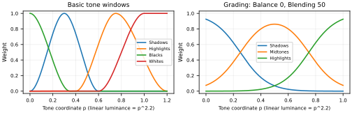

# 1. Scope and reading guide

This is a mathematical and photographic reference to the **implemented pipeline**, traced against commit `30c081d`. It describes what Arraw computes, rather than promising compatibility with another RAW developer's sliders. Equations use real arithmetic; CPU/GPU rounding and finite lookup tables introduce small differences. Defaults and limits refer to the engine, not necessarily the current GUI presentation. Inactive stages are skipped.

Read chapters 2–3 for input and colour foundations; chapters 4–8 for tone, colour, spatial processing and masks; chapter 9 for output; and chapter 10 for terminology. Source links are relative to this document. External links explain concepts; the linked source code defines Arraw's particular formulas. Sections marked as limitations describe present behavior, rather than future plans.

## 1.1 First reading: what development does

A typical colour sensor records a mosaic of differently filtered light measurements. Demosaicing estimates complete red, green and blue (RGB) pixels; white balance corrects the colour of the light; tone tools shape brightness and contrast; colour tools shape colour relationships. Export translates the result into an image another application can display. Development stores choices while leaving the source file intact.

RGB numbers need a colour space to give them meaning, much as coordinates need a map. Its **primaries** define the red, green and blue reference colours; its **white point** defines their neutral mixture. Conversion changes the coordinates to preserve the intended colour as far as the destination allows.

On a first read, follow the photographic explanations and examples; return to the matrix, interpolation and numerical-safeguard details when needed. Chapter order groups related subjects; the pipeline arrows specify execution order. Neither prescribes the order in which you should move sliders. Presence is the group name for Texture, Clarity and Dehaze.

| Photographic intention | Start with |
|---|---|
| Brighten the whole photograph | Exposure, chapter 4 |
| Lower bright clouds or soften their roll toward white | Highlights / Filmic Highlights, chapter 4 |
| Lift a dark subject / raise the deepest black floor | Shadows / Blacks, chapter 4 |
| Change selected subject colours / tint brightness regions | HSL / colour grading, chapter 5 |
| Separate coloured subjects in monochrome | B/W colour mixer, chapter 5 |
| Reduce speckles / change fine or broad local contrast | Noise reduction / Texture / Clarity, chapter 6 |

```{=typst}
#pagebreak(weak: true)
```

```{=latex}
\newpage
```

# 2. The complete processing order

```text
RAW mosaic                         JPEG / PNG / TIFF
    | LibRaw decode                    | Qt decode + profile conversion
    | camera-native linear RGB         | linear Rec.2020
    +-------------------+--------------+
                        |
           [optional source pyramid for preview]
                        |
                 Noise reduction
                        |
            Presence context + mask coverage
                        |
     Camera white balance + matrix to linear Rec.2020
                        |
             Local relative temperature/tint
                        |
             Exposure -> Basic tone
                        |
             Texture + Clarity -> Dehaze
                        |
             Luma curve -> R/G/B curves
                        |
                Filmic highlights
                        |
      HSL -> Saturation -> Vibrance (or B/W) -> Grading
                        |
        Orientation/rotation/straightening/flips/crop
                        |
               Region selection + resize
                        |
                 Vignette -> Grain
                        |
          +-------------+-------------------+
          |                                 |
    sRGB 8-bit display             Output profile conversion
                                  -> output sharpening
                                  -> quantisation/compression
                                  -> selected metadata
```

The diagram distinguishes **calculation of spatial context** from **application of its effect**. Presence reads neighbourhoods of the denoised source before white balance/exposure, but applies its correction after Basic Tone. Mask coverage likewise sets each pixel's effective controls; it is not a stack of separately developed images. Noise reduction operates on already demosaiced data, not the sensor mosaic.

Order matters: exposure changes which tonal window a pixel occupies; a channel curve can change the hue later selected by HSL; grading can add colour after B/W. Filmic highlights precedes the colour block, so it does not guarantee that every final colour channel lies below 1. Geometry and resize operate on developed, linear-light pixels. Output sharpening belongs to export, after output colour conversion.

Sources: [stage table](../src/core/StageTable.h), [pointwise order](../src/core/PointwisePlan.h), [colour block](../src/core/ColorAdjustments.cpp), [render](../src/core/Develop.cpp).

## 2.1 Numbers, units and brightness

A pixel is a vector $\mathbf c=(R,G,B)$, normally accompanied by alpha $\alpha$. Integer input channels become fractions $n/255$ or $n/65535$. Development uses RGBA 32-bit floating-point samples. Alpha expresses coverage/transparency, not brightness; RAW imports receive $\alpha=1$.

In the working encoding, relative luminance is

$$Y=0.2627R+0.6780G+0.0593B.$$

A neutral $(x,x,x)$ has $Y=x$. These are relative values, not measured cd/m², exposure readings, or percentages of sensor electrons. Values above 1 can occur in floating-point development; negative RGB components can describe colours outside the working gamut. Particular operations apply their own floors and clamps.

**Linear light** means doubling a channel doubles its represented light. A perceptually encoded value is nonlinear: doubling it does not double light. The tone coordinate $p=Y^{1/2.2}$ is an editing coordinate, not physical luminance, CIE lightness, or the exact sRGB transfer function. At $Y=0.18$, $p\approx0.459$; at $p=0.5$, $Y\approx0.218$. Thus a window centred near $p=0.7$ is not centred at 70% linear luminance.

**Notation.** A prime means “after this operation”; bold triples hold RGB together. `clamp(x,a,b)` limits x to the interval a…b; `max` chooses the largest argument; Σ adds contributions. A power such as $2^E$ expresses scaling; $\log_2$ counts factors of two. `diag(g)` makes a matrix that multiplies each channel by its own gain; `⊙` is channel-by-channel multiplication; $M^T$ transposes a matrix (and inverts an orthogonal rotation/reflection). `fract(x)=x−floor(x)` wraps an angle to one turn. Symbols are local: smoothstep $S(a,b,x)$ differs from HSV saturation S; Oklab L differs from log-luminance L. The vector $\mathbf1=(1,1,1)$ is a neutral RGB direction; $\lVert\mathbf v\rVert$ denotes a vector’s Euclidean length. A setting named Amount, Detail or Smoothness in an equation is its numerical slider value, unless explicitly divided by 100.

### Four brightness coordinates, one photograph

| Symbol | What it measures | Where it is used |
|---|---|---|
| $Y$ | Weighted linear light | Exposure, luminance tone shaping, B/W base |
| $p=Y^{1/2.2}$ | A convenient nonlinear editing coordinate | Tone windows and curves |
| $V=\max(R,G,B)$ | The largest working RGB channel | HSL-named band controls |
| $L$ in Oklab | Approximate perceptual lightness | Chroma edits and grading's white protection |

For a neutral pixel, $V=Y$; for a coloured pixel they generally differ. A pure working red $(1,0,0)$ has $V=1$ but $Y=.2627$. Thus an HSV-value adjustment and a luminance adjustment select or move different quantities even when both are described informally as “brightness”.

The 18% grey pivot is an editing convention: it does not assert that a particular grey card will decode to exactly .18 under every camera exposure. Likewise, reference white 1 is the working coordinate's nominal white, not a promise that every white object was captured at that value.

A slider value of 50 is meaningful only through that control's equation: it can mean a half-strength coefficient, a 15° weighted band hue shift, or something else. It is never a universal “50% more effect”. The next chapters give the conversions.

# 3. RAW decoding, colour spaces and white balance

## 3.1 What the RAW decoder supplies

Arraw delegates sensor-format decoding and camera-specific preparation to LibRaw's `unpack` / `dcraw_process` path. Sensor black-level handling, scaling, bad-pixel and sensor-specific details therefore belong to that library and depend on the file/camera. Arraw does not implement a separate mathematical sensor calibration or spectral camera model. Its explicit choices are:

| Choice | Setting and photographic consequence |
|---|---|
| Demosaicing | AHD (`user_qual=3`), where applicable; reconstructs three colour channels from filtered sensor samples. |
| Transfer and precision | Linear (`gamm=(1,1)`), 16 bits/channel. Samples reaching the decode maximum are clipped; later floating-point stages can carry values above working white. |
| Colour primaries | Camera-native (`output_color=0`); camera RGB is not sRGB. |
| Brightness | Both automatic brightness and frame-dependent maximum adjustment disabled. A bracket does not receive a separate content-dependent stretch per frame. |
| White balance | Camera WB if recorded; automatic scene WB disabled. Missing WB uses LibRaw daylight multipliers and reports a warning. |
| Orientation | Not baked in (`user_flip=0`); retained for geometry. |
| Highlights | Clip (`highlight=0`), rather than reconstruct missing channels. Later Highlights cannot recover information clipped here. |

A monochrome sensor's single channel is copied to R, G and B. For half-size RAW decoding, each applicable 2×2 sensor block becomes one pixel, avoiding full demosaicing. Already demosaiced linear DNGs that remain full size are explicitly reduced by averaging 2×2 linear blocks, rounding $(\sum n+2)/4$ to an integer. This fallback rounds dimensions down. The separate floating-point preview pyramid rounds odd dimensions up.

Source: [RAW import](../src/core/RawImport.cpp). Background: [LibRaw processing parameters](https://www.libraw.org/docs/API-datastruct-eng.html) and [demosaicing](https://en.wikipedia.org/wiki/Demosaicing). The AHD choice is a request to LibRaw, not a claim that every sensor format executes an identical algorithm.

## 3.2 Colour-space ledger

| Stage | Coordinates/encoding | Purpose |
|---|---|---|
| RAW decode / denoise input | Linear camera RGB, with applied WB recorded | Retain the sensor's channel basis. |
| Standard image import | Embedded profile → linear Rec.2020; assume sRGB if untagged | Decode existing rendered colour correctly. |
| Main development | Linear Rec.2020, D65 | Wide working gamut and linear exposure/blending. |
| Basic tone / curves | Luminance or channels mapped through power 1/2.2 | Shape tones in a more visually convenient coordinate. |
| Saturation / grading | Oklab, derived from working RGB through linear sRGB | Separate lightness and opponent chromatic axes. |
| HSL / B/W hue bands | HSV calculated directly from linear Rec.2020 RGB | Select colours by hue; not HSL of encoded sRGB. |
| Geometry / resize / effects | Linear Rec.2020 | Interpolate light and apply final spatial effects. |
| Curve histogram tap | Signed gamma-2.2 Rec.2020 | Inspect curve input, after Basic Tone and Presence. |
| Display | sRGB, 8-bit RGBA | GUI image prepared by Qt. |
| Export | sRGB, Display P3 or Adobe RGB, 8/16 bit | Deliver a profile-tagged rendered image. |

Arraw uses **Rec.2020 primaries with a linear transfer**, not the standard television transfer function or video limited-range coding. Working RGB does not use PQ/HLG and does not by itself imply an HDR display workflow. See [ITU BT.2020](https://www.itu.int/rec/R-REC-BT.2020), [Rec.2020 overview](https://en.wikipedia.org/wiki/Rec._2020), and [sRGB definition](https://www.color.org/chardata/rgb/srgb.xalter).

The fixed linear sRGB-to-working conversion is

$$M_{s\to w}=\begin{bmatrix}
0.6274039&0.3292830&0.0433131\\
0.0690973&0.9195404&0.0113623\\
0.0163914&0.0880133&0.8955953
\end{bmatrix}.$$

Both spaces use D65; this matrix changes primaries without a separate white-point adaptation. Camera-to-working is $M_{s\to w}M_{camera\to s}$ using LibRaw's camera matrix. This is a three-channel matrix approximation, not spectral reconstruction or a dual-illuminant DNG-profile interpolation implemented by Arraw.

Sources: [space constants](../src/core/ColorSpaces.h), [Qt mappings](../src/core/QtImage.cpp), [standard import](../src/core/ImageImport.cpp).

## 3.3 Temperature and tint: from a light to camera gains

Global RAW WB names the **illuminant being corrected**. Low kelvin describes warm light; high kelvin describes cool light. Raising the assumed temperature generally warms the corrected photograph. Positive tint corrects toward magenta. The engine bounds temperature to 2000–12000 K and tint to −150…+150; non-finite values are rejected.

Arraw uses a 31-entry Robertson locus table in CIE 1960 $u,v$. Temperature is interpolated in reciprocal megakelvin, or mired:

$$m=10^6/T.$$

For the two tabulated entries bracketing $m$, interpolate their $u,v$ coordinates and their unit isotherm directions, then normalise the interpolated direction $\mathbf d$. Tint $t$ moves the selected light to

$$\mathbf q=\mathbf q_{locus}+\frac{t}{-3000}\mathbf d.$$

The tint scale is a convention, not kelvin, a percentage or a spectral measurement. Equal kelvin increments are not equal colour increments; 200 K is a much bigger change near 2000 K than near 10000 K. Zero tint follows the tabulated blackbody locus, not every daylight illuminant.

For $\mathbf q=(u,v)$, put $d=u-4v+2$, $x=1.5u/d$, $y=v/d$, and construct

$$\mathbf X=(x/y,\ 1,\ (1-x-y)/y).$$

Using the stored camera daylight scales $\mathbf s$, recover the sensor response transform

$$A=M_{working\to XYZ}\,M_{camera\to working}\,\operatorname{diag}(\mathbf s),
\qquad \mathbf n=A^{-1}\mathbf X.$$

Floor each $n_i$ to at least $\max(\mathbf n)/1000$ to keep extreme gains bounded, then invert and normalise green:

$$\mathbf g=\left(n_G/n_R,\ 1,\ n_G/n_B\right).$$

For intuition, suppose a neutral subject has camera-channel response $(.5,1,.25)$. Gains $(2,1,4)$ make its corrected channels equal. Those equal camera channels still need the camera matrix to become working-space RGB. The example describes relative channel gains only; real decoder scaling and clipping also matter.

The decoded pixels already contain gains $\mathbf g_{applied}$. Custom WB applies only their ratio, before the camera matrix:

$$\mathbf c_w=M_{camera\to working}
\operatorname{diag}(\mathbf g_{wanted}/\mathbf g_{applied})\mathbf c_{decoded}.$$

As Shot gives an exact unit ratio. Custom mode without either value specified also does so. If only temperature or tint is specified, the missing component comes from the **applied** decode balance. This matters when no camera neutral was recorded. Global Custom WB on already working-space JPEG/PNG/TIFF input is currently rejected: it has no camera response against which to interpret kelvin. Local relative WB is a separate working-RGB adjustment described later.

The neutral eyedropper maps the displayed position back through geometry and averages a source window, normally 7×7 pixels, clipped at edges. For channel sums $S_R,S_G,S_B$, it requests gains proportional to $(S_G/S_R,1,S_G/S_B)$ times the already applied WB, then converts those gains back to temperature/tint. It reads source data rather than the currently edited display, so exposure and grading do not contaminate the pick. A clipped or non-neutral target can still yield an unsuitable balance.

Sources: [WB algorithm and Robertson table](../src/core/WhiteBalance.cpp), [WB composition](../src/core/ColorSettings.cpp). Background: [colour temperature](https://en.wikipedia.org/wiki/Color_temperature), [mired](https://en.wikipedia.org/wiki/Mired), [CIE 1960 colour space](https://en.wikipedia.org/wiki/CIE_1960_color_space), [chromatic adaptation](https://en.wikipedia.org/wiki/Chromatic_adaptation).

# 4. Exposure, tone and curves

## 4.1 Settings, exposure and contrast

[ToneSettings.h](../include/ToneSettings.h) defines exposure in EV, from −5 to +5, and contrast, shadows, highlights, blacks and whites from −100 to +100. [TonePlan.cpp](../src/core/TonePlan.cpp) rejects nonfinite settings and clamps finite out-of-range values. Zero disables a control; an entirely inactive Basic Tone stage skips the power round trip. Filmic Highlights is a separate 0–100 control, default **25**. Consequently a newly opened RAW need not render as an identity transform: the camera matrix and default shoulder still apply, and new RAW state also enables colour noise reduction at 25. “Zero disables a control” refers to that individual control, not the complete default rendering.

Moving Exposure changes the rendering of already recorded light. It brightens noise along with the subject and cannot improve the signal-to-noise ratio that a longer capture exposure might have provided. Every later nonlinear stage sees the changed values, so a +1 EV input gain need not look like an exact doubling of final display brightness.

Exposure multiplies every channel by $2^E$. −5, −1, 0, +1 and +5 EV mean gains $1/32,1/2,1,2,32$. It preserves RGB ratios and doubles linear luminance per positive EV. This is a development adjustment; it cannot undo sensor clipping.

Contrast uses $a=2^{C/200}$ and pivot $g=0.45865646$:

$$p' = g^{1-a}p^a=g(p/g)^a.$$

At settings −100, −50, 0, +50 and +100 the exponent is approximately 0.7071, 0.8409, 1, 1.1892 and 1.4142. The derivative at the pivot is $a$. Positive contrast darkens below middle grey and brightens above it; middle grey stays fixed. Bright values can exceed reference white. In linear luminance this contrast law is equivalently $Y'=0.18(Y/0.18)^a$, up to the rounded pivot. Opposite contrast amounts are inverse exponents when used without intervening controls.

## 4.2 Regional tone weights: what Highlights actually affects

[TonePlan.h](../src/core/TonePlan.h) defines the cubic transition

$$S(a,b,x)=t^2(3-2t),\quad t=\operatorname{clamp}((x-a)/(b-a),0,1).$$

Its slope is zero at both ends. This makes a control fade smoothly rather than select a hard luminance interval. [Smoothstep background](https://en.wikipedia.org/wiki/Smoothstep).

Highlights moves a selected brightness region: lowering it can darken bright cloud texture while affecting darker subjects less. Filmic Highlights instead progressively compresses the brightest differences and fades colour toward white. Strong rolloff can flatten bright texture and make intense colours paler. Its **knee** is where compression begins; its **shoulder** is the continuing bend toward white. Neither reconstructs clipped sensor detail.

The four weights are

$$w_s(p)=S(0,.3,p)[1-S(.3,.6,p)],$$
$$w_h(p)=S(.4,.75,p)[1-S(.75,1.2,p)],$$
$$w_b(p)=1-S(0,.35,p),\qquad w_w(p)=S(.6,1,p).$$

Let $s,h,b,w$ denote the Shadows, Highlights, Blacks and Whites settings in slider units. Their updates are **sequential**:

$$p_1=\text{contrast}(Y^{1/2.2}),$$
$$p_2=p_1+.12(s/100)w_s(p_1),$$
$$p_3=p_2+.12(h/100)w_h(p_2),$$
$$p_4=p_3+.08(b/100)w_b(p_3),$$
$$p_5=p_4+.08(w/100)w_w(p_4),\qquad Y'=\max(p_5,0)^{2.2}.$$

In particular, Highlights reads the result of Shadows; Blacks reads both; Whites reads all preceding updates. Their weights are not all measured once on the original pixel. Changing exposure or contrast changes which region a pixel reaches.




The following table evaluates all four windows at the *same* coordinate, for understanding each individual window. It describes an isolated control (all preceding tone controls zero); with combined controls evaluate the equations above instead.

| Tone coordinate p | Linear Y=p^2.2 | Shadows | Highlights | Blacks | Whites |
|---:|---:|---:|---:|---:|---:|
| 0 | 0.0000 | 0.0000 | 0.0000 | 1.0000 | 0.0000 |
| 0.1 | 0.0063 | 0.2593 | 0.0000 | 0.8017 | 0.0000 |
| 0.2 | 0.0290 | 0.7407 | 0.0000 | 0.3936 | 0.0000 |
| 0.3 | 0.0707 | 1.0000 | 0.0000 | 0.0554 | 0.0000 |
| 0.4 | 0.1332 | 0.7407 | 0.0000 | 0.0000 | 0.0000 |
| 0.5 | 0.2176 | 0.2593 | 0.1983 | 0.0000 | 0.0000 |
| 0.6 | 0.3250 | 0.0000 | 0.6064 | 0.0000 | 0.0000 |
| 0.7 | 0.4563 | 0.0000 | 0.9446 | 0.0000 | 0.1562 |
| 0.75 | 0.5310 | 0.0000 | 1.0000 | 0.0000 | 0.3164 |
| 0.8 | 0.6121 | 0.0000 | 0.9657 | 0.0000 | 0.5000 |
| 0.9 | 0.7931 | 0.0000 | 0.7407 | 0.0000 | 0.8438 |
| 1 | 1.0000 | 0.0000 | 0.4170 | 0.0000 | 1.0000 |
| 1.1 | 1.2333 | 0.0000 | 0.1262 | 0.0000 | 1.0000 |
| 1.2 | 1.4935 | 0.0000 | 0.0000 | 0.0000 | 1.0000 |

Shadows peaks at $p=.3$ ($Y=.0707$) and fades to zero at $p=.6$ ($Y=.3250$), while preserving exact black by itself. Highlights starts at $p=.4$ ($Y=.1332$), peaks at $p=.75$ ($Y=.5310$), and fades to zero at $p=1.2$ ($Y=1.4935$). It therefore also reaches some above-white headroom. Blacks is strongest at zero and gone at $p=.35$ ($Y=.0993$). Whites starts at $p=.6$ and has full weight at and above $p=1$.

“Highlights +50” means adding **0.06 times its weight to the tone coordinate**, not adding 50% luminance or applying half an EV. At the peak $Y=.75^{2.2}=.53105$, Highlights −100 gives $.63^{2.2}\approx.3619$; +100 gives $.87^{2.2}\approx.7361$. The corresponding EV change depends on starting luminance:

$$\Delta EV=\log_2(Y'/Y)=2.2\log_2((p+.12(h/100)w_h(p))/p).$$

The expression assumes an isolated Highlights adjustment, positive $p$, and no clamping. Positive Blacks +100 raises exact black to $.08^{2.2}\approx.00386$; it creates a neutral floor. Negative values are clamped at zero after all regional updates. Positive Whites moves even above-white values upward by .08 at full strength, preserving their distinctions for the later shoulder.

Tone is applied to colour by $\mathbf c'=\mathbf c(Y'/Y)$, preserving working RGB ratios for positive luminance. For $Y\le10^{-20}$ (and for NaN luminance) the active tone stage produces a neutral triplet equal to the shaped black. This avoids unstable division at near-zero luminance. A neutral black lift changes saturation perceptually; RGB-ratio preservation is not a promise to preserve Oklab chroma or all appearance attributes.

## 4.3 Tone curves, including individual colour channels

The curve settings and validation live in [ToneCurveSettings.h](../include/ToneCurveSettings.h); construction and evaluation are in [ToneCurve.cpp](../src/core/ToneCurve.cpp), [ToneCurve.h](../src/core/ToneCurve.h), and [PointwisePlan.h](../src/core/PointwisePlan.h).

A curve's horizontal axis is input tone and its vertical axis is output tone. The diagonal leaves values unchanged; above it brightens that input range, below it darkens it. A steeper local slope separates nearby tones more strongly; a flat portion makes them more alike. A familiar S-shaped curve steepens the middle while flattening its ends. The interpolation described below controls the shape between points; it does not force an intentionally descending set of points to become ascending.

Each curve has 2–16 points $(x_i,y_i)$ in $[0,1]^2$, first $x=0$, last $x=1$, with increasing x separated by at least .01 (tolerance $10^{-6}$). The y values need not increase: an intentionally descending segment is allowed. A point $(.5,.6)$ maps linear input $.5^{2.2}=.21764$ to $.6^{2.2}=.32504$. These coordinates are tone coordinates, not linear light or percentages of output file code values.

The planner builds a Fritsch–Carlson style monotone cubic Hermite interpolant. Define interval widths $d_i=x_{i+1}-x_i$ and secants $q_i=(y_{i+1}-y_i)/d_i$. Endpoint tangents start as the adjacent secant. An interior tangent starts at zero if adjacent secants have opposite signs or either is zero; otherwise it starts at their arithmetic mean. For each flat segment set both tangents zero. Otherwise let $\alpha=m_i/q_i$, $\beta=m_{i+1}/q_i$; if $\alpha^2+\beta^2>9$, replace both with $3(\alpha,\beta)q_i/\sqrt{\alpha^2+\beta^2}$, in interval order. Within an interval, with $t=(x-x_i)/d_i$,

$$F(x)=(2t^3-3t^2+1)y_i+(t^3-2t^2+t)d_im_i+(-2t^3+3t^2)y_{i+1}+(t^3-t^2)d_im_{i+1}.$$

The interpolant is sampled at 1024 uniformly spaced tone-coordinate inputs $j/1023$, using double intermediates and float table entries. Rendering linearly interpolates the table, so actual evaluation is a piecewise linear approximation of the cubic. End table values are set exactly to endpoint y values. [Monotone cubic interpolation background](https://en.wikipedia.org/wiki/Monotone_cubic_interpolation).

Below/equal zero the table evaluator returns $F(0)$; at/above one it uses $F(1)+(x-1)$, a slope-one extension in tone coordinates. This preserves distinct highlight headroom without extrapolating a potentially steep endpoint tangent. The exact two-point identity curve is skipped. Collinear identity points with extra points are evaluated normally.

For the luma curve let $\ell=\max(F(0),0)^{2.2}$, $A=\max(Y,2^{-14})$, and $T=\max(F(A^{1/2.2}),0)^{2.2}$. The result is

$$\mathbf c'=\ell\mathbf1+\mathbf c\,(T-\ell)/A.$$

Above the floor, neutral greys land on the curve exactly apart from table/float approximation. A lifted black is added neutrally rather than multiplying saturated near-black pixels by an unbounded gain. Below $2^{-14}=.00006103515625$ the ratio is held fixed, continuing linearly through zero and negative luminance. NaN luminance takes the neutral lift.

For each channel k, define its own curve $F_k$ and black lift $\ell_k=\max(F_k(0),0)^{2.2}$, separately from the luma lift. The red, green and blue curves then operate **independently on the linear Rec.2020 channels**, each using the tone power coordinate. For positive channel $c_k$, $c_k'=\max(F_k(c_k^{1/2.2}),0)^{2.2}$. For negative $c_k$, $c_k'=c_k+\ell_k$; zero or NaN becomes $\ell_k$. These curves intentionally can change hue, neutral balance and saturation. They are distinct from HSL's named hue bands: the red curve changes the red primary component of every pixel, not just red-looking subjects.

## 4.4 Filmic Highlights: the separate highlight shoulder

The setting $f\in[0,100]$ sets the linear-luminance knee $k=1-.5f/100$. At $f=0$ the shoulder is disabled (infinite knee); any positive setting is active, and its knee approaches 1 as $f$ approaches zero. Default 25 gives $k=.875$; 50 gives .75; 100 gives .5.

Below/equal $k$, nothing changes. Above it define $a=(Y-k)/(1-k)$ and

$$Y_r=k+(1-k)\frac{a}{1+a}.$$

Its slope is $1/(1+a)^2$, initially 1, then decreasing continuously. Finite bright luminances approach 1 asymptotically. It compresses highlight contrast rather than selecting the regional Highlights window. At the default knee, input $Y=.875,1,1.5,2,4$ becomes $.875,.9375,.979167,.9875,.995192$.

There is also a path toward neutral white. Let $r=Y_r/Y$ and $q=r^{3/2}$:

$$\mathbf c'=Y_r\mathbf1+q(r\mathbf c-Y_r\mathbf1).$$

The luminance is $Y_r$ while chromatic deviation from neutral fades. Relative to the original channel-minus-luminance deviation, the scale is $r^{5/2}$; relative to the luminance-scaled colour it is $r^{3/2}$. At exactly zero the shoulder is bypassed. For above-white inputs this differs from an arbitrarily small positive setting, which still compresses them toward white; the setting response is therefore discontinuous at zero for such inputs. The shoulder acts before colour edits: later HSL/grading can still create channels beyond the output gamut. It does not reconstruct colour/detail already lost to sensor saturation.

# 5. Colour adjustments, monochrome and split toning

## 5.1 Per-hue “HSL” controls: actual HSV arithmetic

[ColorAdjustments.cpp](../src/core/ColorAdjustments.cpp) implements these controls using HSV of **linear working RGB**, despite the HSL panel/settings name. It does not convert to gamma-encoded sRGB or use an HSL lightness channel. [HSV/HSL background](https://en.wikipedia.org/wiki/HSL_and_HSV).

For $M=\max(R,G,B)$, $m=\min(R,G,B)$ and $d=M-m$, $V=M$ and $S=d/M$ when $M>10^{-5}$, otherwise $S=0$. Hue is zero when $d\le10^{-5}$. Otherwise use the ordinary HSV sextant formula: $(G-B)/d$ plus 6 if needed for a red maximum; $(B-R)/d+2$ for green; $(R-G)/d+4$ for blue; divide by 6 to obtain turns. The maximum-channel tests prefer red, then green, on ties. Negative working channels are not first clamped; therefore unusual out-of-gamut inputs need not have textbook HSV values.

| Band | Exact centre (turns) | Degrees |
|---|---:|---:|
| Red | 0 | 0 |
| Orange | .083 | 29.88 |
| Yellow | .167 | 60.12 |
| Green | .333 | 119.88 |
| Aqua | .5 | 180 |
| Blue | .611 | 219.96 |
| Purple | .778 | 280.08 |
| Magenta | .889 | 320.04 |

For hue $H$ and centre $c_i$, shortest circular distance is $d_i=\min(|H-c_i|,1-|H-c_i|)$, then $u_i=\max(0,1-6d_i)$ and $w_i=u_i^2(3-2u_i)$. Each band reaches ±60 degrees. At offsets 0, 15, 30, 45, 60 degrees its raw weight is 1, .84375, .5, .15625, 0. Weights $\le.001$ are ignored. **All** remaining bands, including bands whose setting is zero, contribute to the normalizing sum $W$. For each control use the weighted average $\bar x=\sum_iw_ix_i/W$, with settings normalized by 100.

$$H'=\operatorname{fract}(H+\bar h/12),$$
$$S'=\operatorname{clamp}(S(1+.5\bar s),0,1),$$
$$V'=\max(V+.5\bar l,0).$$

Reconstruct RGB with the standard HSV sextant formula: for $j=\lfloor6H'\rfloor$, $t=6H'-j$, define $P=V'(1-S')$, $Q=V'(1-S't)$, $T=V'[1-S'(1-t)]$; sextants 0–5 yield $(V',T,P),(Q,V',P),(P,V',T),(P,Q,V'),(T,P,V'),(V',P,Q)$.

Consequently a weighted hue amount +100 is +30 degrees, +50 is +15 degrees and −100 is −30 degrees. However, setting **only Red** to +100 does not guarantee a full +30-degree turn at red's centre: overlapping neutral bands dilute the average. At $H=0$, red weight is 1, orange approximately .503 and magenta approximately .261; red's effective fraction is about .567, so its turn is about **+17.0 degrees**. If every contributing band is +100 the full +30 degrees applies. Positive turns go red → yellow → green → aqua → blue → magenta → red.

Band saturation +100 means up to ×1.5 HSV saturation, −100 up to ×.5; it is not complete desaturation. Band “luminance” +100 means up to **+.5 linear HSV value**, an additive absolute change, and −100 means −.5, floored at zero. It neither preserves measured luminance nor means 50% brightness; it can affect colours very strongly near black. V is not clamped above 1, so above-white headroom survives this step. Bands are evaluated from the original hue once, not reselected after the hue turn.

If an active HSL adjustment reconstructs a neutral grey after increasing V, it stays neutral; hue settings alone cannot colour an ideal grey because $S=0$. Near-neutral hue membership can still be numerically sensitive because hue is poorly defined at low chroma.

### Hue shift and split toning are different operations

A band hue shift moves a subject's existing colour around the HSV wheel: an orange subject can become more yellow or red, while a neutral grey has no saturation to rotate. Grading adds a tint selected by brightness region and can colour a neutral grey. “Blue highlights” in grading therefore describes added blue tint, not a command to rotate every bright subject by the same angle. A red channel curve is a third operation: it changes the red component of every pixel that reaches that channel value.

## 5.2 Oklab saturation and vibrance

These controls use Oklab, not HSV. The conversion first takes linear Rec.2020 to linear sRGB with

$$M_{2020\to sRGB}=\begin{bmatrix}1.660491&-.587641&-.072850\\-.124550&1.132900&-.008349\\-.018151&-.100579&1.118730\end{bmatrix}.$$

Then $\mathbf l=M_1\mathbf c_{sRGB}$, signed componentwise cube roots $\mathbf u=\operatorname{cbrt}(\mathbf l)$, and $(L,a,b)^T=M_2\mathbf u$, where

$$M_1=\begin{bmatrix}.4122214708&.5363325363&.0514459929\\.2119034982&.6806995451&.1073969566\\.0883024619&.2817188376&.6299787005\end{bmatrix},$$
$$M_2=\begin{bmatrix}.2104542553&.7936177850&-.0040720468\\1.9779984951&-2.4285922050&.4505937099\\.0259040371&.7827717662&-.8086757660\end{bmatrix}.$$

For completeness the inverse first forms

$$\begin{aligned}
u_l&=L+.3963377774a+.2158037573b,\\
u_m&=L-.1055613458a-.0638541728b,\\
u_s&=L-.0894841775a-1.2914855480b.
\end{aligned}$$

cubes these components, then multiplies by

$$M^{-1}_1=\begin{bmatrix}4.0767416621&-3.3077115913&.2309699292\\-1.2684380046&2.6097574011&-.3413193965\\-.0041960863&-.7034186147&1.7076147010\end{bmatrix}$$

to obtain linear sRGB, and by

$$M_{sRGB\to2020}=\begin{bmatrix}.627404&.329283&.043313\\.069097&.919541&.011362\\.016391&.088013&.895595\end{bmatrix}$$

to return to working RGB.

Signed cube roots preserve negative LMS components rather than producing NaNs from fractional powers. The inverse is explicitly implemented with the rounded constants in [ColorAdjustments.cpp](../src/core/ColorAdjustments.cpp), followed by the linear-sRGB-to-Rec.2020 matrix. The finite-precision forward and inverse are approximate inverses, not symbolic inverses. See [Oklab's original explanation and derivation](https://bottosson.github.io/posts/oklab/).

Global/local saturation $s\in[-100,100]$ scales $(a,b)$ by $1+s/100$, holding $L$ fixed. −100 removes Oklab chroma, 0 skips the conversion when inactive, +100 doubles it. This is different from the narrower HSV band saturation range. Holding Oklab lightness does not guarantee identical linear luminance. No gamut clamp is made here.

Vibrance $v\in[-100,100]$ first measures $C=\sqrt{a^2+b^2}$, computes $w=.2/(.2+C)$ and scales chroma by $1+(v/100)w$, holding $L$ fixed. At chromas 0, .05, .1, .2 and .4 the weight is 1, .8, .6667, .5 and .3333. Weakly coloured pixels therefore change proportionally more; exact greys still have zero chroma to scale. There is no skin-hue protection. Vibrance follows saturation, so its weight measures the already-adjusted chroma.

## 5.3 Black-and-white conversion and colour mixer

When B/W is enabled it **replaces** HSL, saturation and vibrance. It reads the post-curve, post-shoulder working colour, calculates its Rec.2020 luminance $Y$ and HSV hue/saturation, and uses exactly the same circular band weights and normalization described above. The eight grey-mix settings are raw values $m_i\in[-100,100]$, zero by default. Let $\bar m=\sum_iw_im_i/W$:

$$G=\max\left(Y[1+(\bar m/100)S],0\right),\qquad\mathbf c'=(G,G,G).$$

For no contributing weights the gain is 1. With ordinary $S\in[0,1]$, a fully effective +100 doubles fully saturated colours (one EV), −100 makes them black; at $S=.5$ the same settings give ×1.5 and ×.5. Neutral greys are unchanged regardless of band sliders because $S=0$. As in HSL, changing one band is diluted by overlapping zero-valued neighbours; the slider is not a direct independent RGB coefficient. Default B/W is luminance conversion, not a simple channel average, film emulation, or an RGB-to-CIE-L* conversion. Colour grading after B/W can produce split-toned or fully tinted monochrome.

The mixer still reads its incoming post-tone colour to choose the displayed grey, even though that colour is absent from the monochrome result. Lowering Blue can darken a blue sky relative to clouds; raising Orange can lighten orange-toned skin. Actual strength depends on saturation and overlapping bands. For effective mix +50 and saturation .5, grey becomes $Y(1+.5\times.5)=1.25Y$, about +.322 stop. This is digital colour-dependent brightness adjustment, not a simulation of a physical lens filter.

## 5.4 Three-zone colour grading and split toning

[ColorGrading.cpp](../src/core/ColorGrading.cpp) implements shadows, midtones and highlights as overlapping normalized Gaussian bells in the tone coordinate. Each zone has hue angle $\theta$ and saturation strength $s\in[0,100]$. Angles are **Oklab a–b angles**, measured from +a toward +b: approximately 30° red, 110° yellow, 140° green, 260° blue. They are not the HSV angles above and matching numbers do not match colours. Rendering wraps finite hue angles modulo 360; public input readers enforce their documented range.

Each zone's full-weight tint is

$$\phi_i=\pi\theta_i/180,\qquad\mathbf t_i=.10(s_i/100)(\cos\phi_i,\sin\phi_i).$$

Use the displayed colour wheel as the visual guide: the angle is a colour direction and does not quantify “degrees warmer”. A 360° turn returns to the same hue. Thus saturation 50 means an Oklab chroma *offset magnitude* .05, not multiplication of existing chroma by 1.5. Adding this vector can reinforce, neutralize or rotate an existing colour depending on its direction.

Balance $b\in[-100,100]$ shifts the tonal coordinate by $.25b/100$. Blending $j\in[0,100]$ sets width $\sigma=.18+.27j/100$ (default 50 gives .315). For $p=\operatorname{clamp}(\operatorname{clamp}(Y,0,1)^{1/2.2}+.25b/100,0,1)$ and centres $c_i=0,.5,1$,

$$q_i=\exp[-((p-c_i)/\sigma)^2],\qquad w_i=q_i/\sum q_i.$$

These are nonnegative weights summing to one, not hard thirds of linear luminance. Larger Blending broadens overlap. Negative Balance lowers p and gives shadows more territory; positive Balance gives highlights more. The midtone centre is $p=.5$, corresponding to linear $Y=.21764$, not $.5$. The symbol $\sigma$ here is the bell width in $\exp[-(d/\sigma)^2]$; it is not the Gaussian standard deviation used in spatial filters. Their equivalent standard deviation would be $\sigma/\sqrt2$. A zone with zero tint still participates in weight normalisation, so neighbouring zones are not automatically strengthened to replace it.

Before applying the combined tint, compute Oklab $L,a,b$ and fade $f=1-S(.85,1,L)$. Then

$$(a',b')=(a,b)+f\sum_iw_i\mathbf t_i,\quad L'=L.$$

The tint is whole below/equal $L=.85$, half at $.925$, and absent at/above 1. This protects near-white headroom; it is a fade in Oklab lightness, distinct from the luminance used for zone selection. If all zone saturations are zero the entire grade is skipped regardless of balance/hue/blending. At fade zero the original colour is returned without an Oklab round trip.

For a split-toned monochrome, choose blue shadows and warm highlights, then raise their saturation strengths: dark and light neutrals take different tints while the brightest whites are protected. Hue alone does nothing at zero strength. Adding blue cools neutral shadows but may partly neutralise orange shadows rather than turn every shadow blue. Balance expands one tonal treatment; Blending broadens overlap.

Grading holds Oklab lightness rather than linear luminance, has no independent per-zone exposure/lightness control, and is followed by no second shoulder in the pointwise chain. Strong tinting can still exceed the eventual output gamut.

# 6. Noise reduction and Presence

Here $S(a,b,x)$ is smoothstep. The signed power coordinate is $P(x)=\operatorname{sign}(x)|x|^{1/2.2}$ with inverse $P^{-1}(v)=\operatorname{sign}(v)|v|^{2.2}$. The fixed as-shot row is $\mathbf r=\mathbf y^T M_{camera\to working}$, with $\mathbf y=(0.2627,0.6780,0.0593)$; working-space input uses $\mathbf y$ directly. This excludes editable white-balance changes.

## 6.1 Noise reduction

Implementation: [Denoise.cpp](../src/core/Denoise.cpp), [constants and decomposition](../src/core/Denoise.h), [public settings](../include/NoiseReductionSettings.h).

All four controls have range 0–100. The settings defaults are luminance 0, Detail 50, colour 0, Smoothness 50. A newly imported RAW starts with colour amount 25. Both filtering components are skipped if their effective activation predicates are false; Detail alone does nothing, and colour requires both colour amount and Smoothness above zero.

Inspect smooth shadows for speckles, hair/fabric for lost brightness detail, and colour boundaries for colour bleeding. Higher Detail can preserve noise as well as real edges. Compare at close zoom: a fitted preview can conceal both noise and smoothing (chapter 9).

### Luminance and colour separation

Let $Y=\mathbf r\cdot\mathbf c$, $\mathbf n=\mathbf1/(r_R+r_G+r_B)$, $\varepsilon=2^{-14}$, and $D=\max(Y,0)+\varepsilon$. The source colour becomes a luminance and a unit-luminance colour ratio:

$$
\begin{aligned}
\mathbf q&=\frac{\mathbf c+(D-Y)\mathbf n}{D},\\
\mathbf c&=D\mathbf q-(D-Y)\mathbf n.
\end{aligned}
$$

The ratio has unit source luminance: $\mathbf r\cdot\mathbf q=1$. Its three channels describe the colour remaining when brightness is factored out; they are not an HSV saturation or a perceptual chroma vector. The offset handles black and negative luminance continuously. For a positive neutral working-space input $(x,x,x)$, the ratio is $(1,1,1)$; recombining it with a different positive luminance makes a different neutral grey. Recombination recomputes $D$ from filtered luminance. Luminance filtering smooths brightness; colour filtering smooths $\mathbf q$.

### Luminance Amount and Detail

Here $i$ is the pixel being filtered, $j$ is a neighbouring sample along the current axis, and $d_{ij}$ is their separation in current-source pixels. The **separable bilateral** runs horizontally then vertically, recomputing perceptual edge coordinates between passes:

$$
\begin{aligned}
v(Y)&=\max(Y,0)^{1/2.2},\\
w_{ij}&=\exp\!\left(-\frac{d_{ij}^2}{2\sigma_s^2}\right)
         \exp\!\left(-\frac{[v(Y_i)-v(Y_j)]^2}{2\sigma_r^2}\right),\\
F(Y)_i&=\frac{\sum_j w_{ij}Y_j}{\sum_j w_{ij}},\\
Y_{\mathrm{out}}&=Y+\frac{\mathrm{Amount}}{100}[F(Y)-Y],\\
\sigma_s&=\frac{2}{\mathrm{pixelScale}},\qquad
\sigma_r=0.20-0.18\frac{\mathrm{Detail}}{100}.
\end{aligned}
$$

`pixelScale` is sensor pixels per decoded-source pixel. At full resolution the spatial sigma is two sensor pixels. Taps extend to $\lceil3\sigma_s\rceil$, bounded to 1–64; edges extend their nearest pixel. Amount 50 replaces half the original luminance with the filtered result, rather than doubling the radius or changing the edge threshold. At Detail 0, 50 and 100, range sigma is respectively 0.20, 0.11 and 0.02 in the perceptual coordinate. A neighbour differing by exactly one range sigma has range weight $\exp(-1/2)\approx0.607$; two sigma gives about 0.135. Greater Detail therefore preserves weaker edges, and can also preserve more noise.

This approximation can produce faint cross-shaped artefacts at strong settings. See [Bilateral filter](https://en.wikipedia.org/wiki/Bilateral_filter).

### What sigma and Gaussian blur mean

A Gaussian blur gives nearby samples more weight than distant ones. In one dimension its unnormalised spatial weight is

$$k(d)=\exp\!\left(-\frac{d^2}{2\sigma^2}\right),\qquad
\widehat k(d)=\frac{k(d)}{\sum_j k(d_j)}.$$

Sigma controls width, not blend strength: at distances $\sigma$ and $2\sigma$, the relative weights are about .607 and .135. Arraw truncates these kernels at roughly three sigma and normalises the retained taps. In a bilateral filter, the second Gaussian additionally reduces contributions from neighbours with different brightness. In a plain Gaussian colour blur there is no such edge test. Grid-cell sigma must be multiplied by cell width to compare it with a radius measured in image pixels.

### Colour Amount and Smoothness

The implementation first averages source RGB over square grid cells, then decomposes each mean colour into its ratio $\mathbf q$. At full resolution a cell spans 4×4 source pixels; partial edge cells average only existing pixels. For other source scales the side length is the largest power of two no larger than $\operatorname{clamp}(\lfloor4/\mathrm{pixelScale}\rfloor,1,4)$.

Each ratio channel is Gaussian blurred horizontally and vertically, with:

$$
\begin{aligned}
\sigma_{\mathrm{colour}}&=\frac{0.25\,\mathrm{Smoothness}}
 {\mathrm{pixelScale}\,\mathrm{cellSide}},\\
\mathbf q_{\mathrm{out}}&=\mathbf q+\frac{\mathrm{ColourAmount}}{100}
 [\operatorname{bilinearRead}(\mathrm{blurredGrid})-\mathbf q].
\end{aligned}
$$

Sigma is in grid cells; equivalently Smoothness 100 corresponds to 25 sensor pixels, 50 to 12.5. The Gaussian radius is again $\lceil3\sigma\rceil$ bounded to 1–64. Colour 25 blends one quarter of the smoothed ratio back. This is deliberately not an edge-preserving colour blur: excessive Smoothness can spread colour across boundaries. Because ratios are derived after averaging RGB, dark source pixels contribute less to the cell's colour than bright pixels.

## 6.2 Texture, Clarity and Dehaze

Implementation: [Presence.cpp](../src/core/Presence.cpp), [constants and contract](../src/core/Presence.h). Each slider runs from −100 to +100 and becomes an amount $a=\mathrm{slider}/100$. All three default to zero. The whole Presence stage returns the colour unchanged when current working luminance is not greater than $10^{-20}$, including for NaN luminance; its ratio-based effects need a usable positive brightness.

### Shared neighbourhood measurement

The context reads the denoised source, before editable balance, tone and colour changes. Each source luminance is bounded to $[2^{-14},2^{16}]$; values at or below the floor, including NaN, measure as the floor, and positive infinity measures as the ceiling. A grid cell stores **logarithm of mean linear luminance**, $\log_2(\operatorname{mean}(Y))$, not mean logarithm. Grids are Gaussian blurred in log space, edges clamped, and sampled bilinearly at each source pixel.

Texture uses sigma four sensor pixels and cells two sensor pixels wide at full resolution. Clarity's sigma is 1% of the uncropped sensor long edge: 60 pixels on a 6000-pixel frame. Its cells use the largest power of two no larger than roughly sigma/4, giving four to eight cells per sigma. The same coarse cell layout supports Dehaze. Source-scale conversion chooses power-of-two cell sizes, clamps grid sigma to $[1,64/3]$, and bounds blur radius to 64 cells. At deep preview levels Texture therefore stops getting finer and uses at least one grid-cell sigma. The result is a scale-aware preview approximation.

Let $L=\log_2(Y_{\mathrm{source,bounded}})$; $B_f$ be Texture's blurred grid; $C$ the unblurred coarse grid; and $B_c$ Clarity's blurred coarse grid. These are all log2 measurements. A difference of one means a luminance ratio of two in the measured neighbourhood. Importantly, $L$ is the source measurement, while the working colour being changed has already received preceding tone operations.

### Texture

Define $Q(d,k)=d/(1+|d|/k)$. It has slope one at zero and asymptotically approaches $\pm k$. Texture adds:

$$
s_{\mathrm{texture}}=a_{\mathrm{texture}}Q(L-B_f,0.5),
\qquad \mathbf c_{\mathrm{out}}=2^{s_{\mathrm{texture}}}\mathbf c.
$$

A positive setting brightens details above their local base and darkens those below it; negative settings compress this fine contrast. At +100, a detail one stop above its base receives $1/(1+1/0.5)=1/3$ extra stop, a gain about 1.260. A −1-stop detail receives a gain about 0.794. Regardless of an edge's contrast the added change stays below half a stop in magnitude at full setting. Multiplication by one common gain preserves RGB ratios.

### Clarity and its luminance weighting

Clarity excludes detail finer than the coarse grid cell by using $C-B_c$. Let $v=\operatorname{clamp}(Y_{\mathrm{working}},0,1)^{1/2.2}$ and:

$$
\begin{aligned}
M(v)&=S(0,0.8,1-|2v-1|),\\
s_{\mathrm{clarity}}&=a_{\mathrm{clarity}}M(v)Q(C-B_c,1),\\
s&=s_{\mathrm{texture}}+s_{\mathrm{clarity}},\qquad
\mathbf c_{\mathrm{out}}=2^s\mathbf c.
\end{aligned}
$$

The weight is zero at perceptual black and white, reaches full strength for $v\in[0.4,0.6]$, and fades smoothly outside that band. In linear luminance the full-strength band is approximately $[0.133,0.325]$. At $v=0.2$ or $0.8$ (linear luminance about 0.029 or 0.612), the weight is one half. Values at or above linear white get zero Clarity weight. At full strength the extra change is bounded below one stop in magnitude; a one-stop coarse-band difference receives half a stop before this midtone weighting. This is separate from the shared black safeguard at the start of Presence, which also bypasses Dehaze.

Texture shapes fine surface detail; Clarity shapes broader local contrast.

### Positive Dehaze: finding and subtracting a veil

The floor starts from coarse log-luminance cells and applies a morphological opening: minima then maxima along horizontal, vertical and both diagonal axes. The structuring element approximates a regular octagon of inradius 3% of the sensor long edge (180 pixels for a 6000-pixel edge). Two reconstruction steps take the maximum over each 3×3 neighbourhood, bounded by the original cell. A Gaussian sigma 0.25% of the long edge smooths the result, with the final floor never below its reconstructed opening. Denote the sampled result $F$. This neighbourhood minimum/maximum construction is a form of [mathematical morphology](https://en.wikipedia.org/wiki/Mathematical_morphology).

Let $\mathbf c_0$ be the colour entering Presence. Texture and Clarity produce $\mathbf c_t=2^s\mathbf c_0$, with luminance $T=Y(\mathbf c_t)=Y_{\mathrm{working}}2^s$. The following Dehaze equations act on $\mathbf c_t$; they do not apply the Texture/Clarity gain a second time. Protect nearly white values with $O=1-S(0.75,1.25,T)$. Thus this openness is one at and below 0.75, one half at 1.0, and zero at and above 1.25 in linear working luminance. For positive amount $a$:

$$
h=2^{\min(F-C,0)}O,\qquad
\mathbf c_{\mathrm{out}}=(1-0.6ah)\mathbf c_t.
$$

For a floor one stop below the coarse cell, $F-C=-1$, with full openness $O=1$, the share is $h=.5$. At Dehaze +100, the RGB multiplier is $1-.6(.5)=.7$, or about −.515 EV before the chroma correction. At full amount and floor share the colour retains 40% (about −1.322 stops). Brighter cells receive less attenuation. Smoothly multiplying fine detail reduces noise amplification. This artistic veil estimate cannot reconstruct lost capture detail.

### Negative Dehaze: adding a veil

For negative amount the context instead supplies a broad log-luminance mean $B_h$, Gaussian sigma 2% of the sensor long edge:

$$
\begin{aligned}
\mu&=T\,2^{\min(B_h-L,6)},\\
V_{\mathrm{veil}}&=(-a)\,0.4\,O\mu,\qquad
\mathbf c_{\mathrm{out}}=\mathbf c_t+V_{\mathrm{veil}}\mathbf1,\\
h&=\begin{cases}
V_{\mathrm{veil}}/(T+V_{\mathrm{veil}})&V_{\mathrm{veil}}>0,\\
0&V_{\mathrm{veil}}=0.
\end{cases}
\end{aligned}
$$

The six-stop cap limits how much a bright neighbourhood can lift a very dark pixel. An equal channel addition washes out contrast and colour as a simulated veil.

Both signs then make an Oklab chroma correction. To avoid confusing this internal multiplier with the chapter 5 slider units, write it explicitly as

$$(a_{\mathrm{ok}}',b_{\mathrm{ok}}')=(1+0.16ah)(a_{\mathrm{ok}},b_{\mathrm{ok}}),\qquad L_{\mathrm{ok}}'=L_{\mathrm{ok}}.$$

Here $a$ is the normalised Dehaze amount; $a_{\mathrm{ok}},b_{\mathrm{ok}}$ are Oklab chromatic coordinates of the just-dehazed colour. Positive Dehaze increases chroma by up to 16%; negative decreases it according to the added veil share. The factor is not a slider value of 0.16. Its strength follows the estimated veil share. The positive and negative algorithms are intentionally asymmetric; a +50 edit and a −50 edit do not invert one another.

# 7. Local adjustments and masks

Implementation: [LocalPlan.cpp](../src/core/LocalPlan.cpp), [mask evaluation](../src/core/LocalPlan.h), [effective pixel settings](../src/core/PointwisePlan.h), [brush rasterisation](../src/core/BrushRaster.cpp), [coverage quantisation](../src/core/BrushCoverage.h).

Coverage 0, .5 and 1 means no, half and full contribution to the local settings. Normalised opacity/flow .5 means 50% where a UI displays percentages; feather describes transition width, not overall strength.

A local adjustment contains an enabled flag, opacity $[0,1]$, optional inversion, a mask and deltas for thirteen controls: relative Temperature, relative Tint, Exposure, Contrast, Highlights, Shadows, Whites, Blacks, Texture, Clarity, Dehaze, Saturation and Vibrance. Disabled adjustments contribute nothing. For control $c$ at pixel $p$, let $g_c$ be its global setting and $[\ell_c,u_c]$ its allowed range. Its effective value $e_c(p)$ is:

$$
\begin{aligned}
s_c(p)&=\sum_i w_i(p)\,\mathrm{opacity}_i\,\Delta_{i,c},\\
e_c(p)&=\operatorname{clamp}\!\left(g_c+s_c(p),\ell_c,u_c\right).
\end{aligned}
$$

Masks add in **setting units** before the global value and final clamp; opposite contributions can cancel. The global operation runs once with the effective setting. Exposure deltas are stops: opacity 0.5 times a +2-stop delta contributes +1 stop at full coverage. Other deltas retain slider units; each acts at its existing pipeline stage.

For example, a global Exposure of +.5 EV plus two full-coverage local contributions, +2 EV at opacity .5 and −.5 EV at opacity 1, gives +1 EV overall: $.5+(.5)(2)-.5=1$. Overlapping adjustments are summed in stored list order before one clamp. Near an endpoint, clamping limits the combined request: a global +4.5 EV and a local +2 EV become +5 EV, not +6.5 EV. Mask order is not a stack of repeated tone curves or separately exposed layers.

Local controls do not include independent tone curves, HSL band edits, B/W mixers, grading zones, noise reduction, geometry or effects. A mask can vary the listed controls at each source location; it does not insert those missing operations into the pipeline.

### Coordinates and geometric masks

Masks live in original, uncropped source coordinates. Points store fractions $(u,v)$ of source width and height. Distances and radii use an isotropic metric divided by the source's long edge $E=\max(W,H)$, so a circle remains circular on a rectangular photograph. Explicitly, a stored position $(u,v)$ becomes $(uW/E,vH/E)$ for isotropic distance calculations, and source pixel centre $(x+.5,y+.5)$ becomes $((x+.5)/E,(y+.5)/E)$. A radial radius .1 therefore means one tenth of the source long edge on either axis, not one tenth of each separate side. Geometry transforms move masks with the photograph.

For a linear mask with endpoints $\mathbf A$ and $\mathbf B$ in this metric, project the pixel onto the gradient:

$$
t=\frac{(\mathbf P-\mathbf A)\cdot(\mathbf B-\mathbf A)}
 {\lVert\mathbf B-\mathbf A\rVert^2},\qquad w=1-S(0,1,t).
$$

Coverage is one at and beyond the `from` side, zero at and beyond `to`, and one half on the centre line. The falloff is smoothstep, not a straight linear ramp.

For a radial mask, rotate $(\mathbf P-\mathbf{centre})$ by minus its angle, divide the coordinates by its two radii $r_x,r_y$, and take their Euclidean length $d$. With feather fraction $f$:

$$
r_{\mathrm{inner}}=1-\max\!\left(f,\frac{1}{E\min(r_x,r_y)}\right),
\qquad w=1-S(r_{\mathrm{inner}},1,d).
$$

Coverage is one inside $r_{\mathrm{inner}}$, one half halfway through that falloff, and zero at and outside the ellipse $d=1$. The one-source-pixel minimum falloff avoids an infinitely steep edge. Inversion replaces any mask weight by $1-w$.

### Brush masks

Brush strokes are sequences of dabs at arc-length spacing one quarter of the stored radius, with a first dab and, where necessary, a final endpoint dab. Stored radius is a fraction of source long edge. The drawn radius is $r=\max(r_{\mathrm{stored}}E,1.5)$ pixels; when widened to 1.5 pixels the flow is multiplied by $(r_{\mathrm{original}}/r)^2$ to conserve its approximate area contribution. The fully covered inner radius is $\min(\mathrm{hardness}\,r,r-1)$ pixels.

For pixel distance $d<r$ from a dab centre, coverage influence is $b=\mathrm{flow}[1-S(r_{\mathrm{inner}},r,d)]$. Outside the radius it is zero. Dabs update existing coverage $m$ in stroke order:

$$
\begin{aligned}
\text{paint:}\quad m'&=m+b(1-m),\\
\text{erase:}\quad m'&=m(1-b).
\end{aligned}
$$

At a fully covered dab centre, two flow-0.5 paint dabs yield coverage 0.75. Erasing multiplies coverage.

Coverage becomes $\min(255,\lfloor255\operatorname{clamp}(m,0,1)+\mathrm{threshold}\rfloor)$, using a shifted 4×4 Bayer threshold per mask. Processing reads $\mathrm{code}/255$. Dithering preserves zero and one; preview coverage can differ from full resolution.

### Relative Temperature and Tint

Local relative balance is a working-RGB diagonal gain, not a second camera temperature expressed in kelvins. Clamp the summed relative controls $T,N$ to $[-100,100]$, then compute:

$$
\begin{aligned}
g_R&=2^{0.16T/100+0.19N/100},\quad g_G=1,\quad
 g_B=2^{-0.43T/100+0.31N/100},\\
\widehat{\mathbf g}&=\frac{\mathbf g}{0.2627g_R+0.6780g_G+0.0593g_B},\\
c_{\mathrm{out},k}&=\widehat g_k c_k,\qquad k\in\{R,G,B\}.
\end{aligned}
$$

This keeps a neutral's luminance unchanged. It does not generally preserve the luminance of an already coloured pixel. Positive Temperature warms by favouring red over blue; positive Tint favours red and blue over green. Texture/Clarity/Dehaze neighbourhoods still come from the shared source context, even where local settings differ.

# 8. Geometry and finishing

## 8.1 Geometry: orientation, rotation, flipping and crop

Implementation: [GeometryPlan.cpp](../src/core/GeometryPlan.cpp). Geometry runs on developed floating-point working RGB, after pointwise adjustments and before resizing.

For example, bilinear sampling halfway between two opaque neighbours gives each half the weight. Interpolating black and white in linear light gives .5 linear luminance, which encodes to about .735 in sRGB; averaging their encoded sRGB values instead gives .5, only about .214 linear light. This is why geometry and resize interpolate before display encoding. Alpha premultiplication extends this rule to partially covered pixels without mixing hidden colours into the visible edge.

The source-centred orthogonal matrix is $M=M_{\mathrm{flip}}M_{\mathrm{fine}}M_{\mathrm{quarter}}M_{\mathrm{orientation}}$. Camera orientation includes the eight standard EXIF orientations, including reflections. Quarter-turns use exact matrices; straighten uses $\bigl[\begin{smallmatrix}\cos\phi&-\sin\phi\\\sin\phi&\cos\phi\end{smallmatrix}\bigr]$, with $\phi=\pi\theta/180$ for θ in degrees, allowed $[-45,+45]$. Image y increases downward, so positive angular rotation is clockwise visually. Camera reflections do not commute with straighten; the fixed multiplication order matters.

For source $(W,H)$, upright dimensions are $(|M_{00}|W+|M_{01}|H,\ |M_{10}|W+|M_{11}|H)$. Crop edges are fractions of this box. Automatic crop maximises centred area within source content, respecting any aspect constraint. Explicit crops are fitted into content; aspect agreement requires relative tolerance $10^{-6}$. Raster dimensions are floored to at least one pixel, repairing floating-point error near integers.

Output centres map to $\mathbf p_u=(l+(x+0.5)W_c/W_o,\ t+(y+0.5)H_c/H_o)$, where $(l,t)$ is the crop origin, $(W_c,H_c)$ its dimensions and $(W_o,H_o)$ the output dimensions, then to source with $M^T$ and centred translations. Bilinear sampling clamps boundaries and interpolates premultiplied RGB/alpha before unpremultiplying. Zero alpha yields transparent black; exact source-centre alignment copies pixels. Straightening resamples; aligned crops and quarter-turns can avoid interpolation blur. No lens or perspective correction occurs.

## 8.2 Resize and reconstruction filters

Implementation: [ResampleWeights.cpp](../src/core/ResampleWeights.cpp), [Resample.cpp](../src/core/Resample.cpp). Both axes run as separate passes in linear working RGB. Available kernels are:

$$
\begin{aligned}
K_{\mathrm{bilinear}}(x)&=\max(1-|x|,0),\\
K_{\mathrm{Lanczos3}}(x)&=\begin{cases}
\operatorname{sinc}(x)\operatorname{sinc}(x/3)&|x|<3,\\
0&|x|\ge3,
\end{cases}\\
\operatorname{sinc}(x)&=\begin{cases}
\sin(\pi x)/(\pi x)&x\ne0,\\
1&x=0.
\end{cases}
\end{aligned}
$$

For one axis with $s=N_{\mathrm{out}}/N_{\mathrm{in}}$, the input-space centre is $(x+0.5)/s-0.5$. Kernel stretch is $h=\max(1,1/s)$ and each tap has unnormalised weight $K((i-x_{\mathrm{centre}})/h)$, then weights are normalised to sum to one. Thus downscaling widens the footprint for anti-aliasing; upscaling uses the base kernel. Equal input/output size is an exact identity on that axis. Boundaries extend the nearest pixel. [Lanczos resampling](https://en.wikipedia.org/wiki/Lanczos_resampling) explains the windowed-sinc reconstruction idea and its ringing tradeoff.

The computation premultiplies alpha to avoid hidden RGB bleeding into visible edges. Alpha is clamped to $[0,1]$ on reconstruction. Near transparency, RGB is constrained to the range of contributing visible colours to suppress signed-kernel fringes. Opaque areas retain Lanczos overshoot except for a rule preventing negative ringing when no negative source samples contributed. Working values above white can survive resize. Bilinear is softer and has nonnegative weights; Lanczos better retains fine detail but can ring around sharp edges.

## 8.3 Post-crop vignette

Implementation: [Effects.cpp](../src/core/Effects.cpp), [constants](../src/core/Effects.h). Amount is $[-100,100]$; Midpoint and Feather are $[0,100]$, both defaulting to 50. Amount zero disables the vignette.

Use normalised crop coordinates $(x,y)\in[0,1]^2$, evaluated at pixel centres. The elliptical radius, normalised to one in the corners, is:

$$
\begin{aligned}
r&=\sqrt{\frac{(2x-1)^2+(2y-1)^2}{2}},\\
r_{\mathrm{inner}}&=0.85\frac{\mathrm{Midpoint}}{100},\\
r_{\mathrm{outer}}&=\max\!\left(r_{\mathrm{inner}}+
 (1-r_{\mathrm{inner}})\frac{\mathrm{Feather}}{100},
 r_{\mathrm{inner}}+0.0001\right),\\
w&=S(r_{\mathrm{inner}},r_{\mathrm{outer}},r).
\end{aligned}
$$

Feather exactly zero instead uses a hard step $w=1$ when $r\ge r_{\mathrm{inner}}$, zero otherwise. Increasing Midpoint pushes the start of the effect towards the corners. Feather changes the falloff width rather than reducing maximum Amount. At Midpoint 50, Feather 50, the falloff starts at radius 0.425 and ends at 0.7125; its midpoint is 0.56875.

Let $s=2|\mathrm{Amount}|/100$. Negative Amount multiplies linear RGB by $2^{-sw}$. Amount −100 at full falloff is exactly −2 stops, one quarter of the input; at weight one half it is −1 stop. Positive Amount instead screens towards white in the signed perceptual coordinate:

$$
k=2^{-sw/2.2},\qquad
c_{\mathrm{out}}=P^{-1}\!\left(1-[1-P(c)]k\right).
$$

Positive Amount lifts black and preserves reference white. “Two stops” calibrates strength rather than a uniform +2 EV change. This crop-relative artistic vignette does not correct optical vignetting.

## 8.4 Grain

Implementation: [GrainModels.cpp](../src/core/GrainModels.cpp), [constants](../src/core/GrainModels.h). Amount, Size and Roughness range from 0–100. Amount defaults to zero; Size and Roughness default to 50. The sole model is deterministic smooth value noise.

Amount sets the full-detail standard deviation in the internal perceptual coordinate:

$$
\sigma=0.08\frac{\mathrm{Amount}}{100},\qquad
\mathrm{size}=\frac{0.5}{2048}\,8^{\mathrm{Size}/100},\qquad
c_{\mathrm{out}}=P^{-1}(P(c)+g).
$$

One scalar $g$ enters all three perceptual channels: monochromatic grain. Amount 50 gives deviation 0.04. On a 2048-pixel long edge, Size 0, 50 and 100 yield base cells of 0.5, 1.414 and 4 pixels. Size is logarithmic and relative to the cropped long edge.

A lattice vertex is a deterministic hash of integer coordinates and seed, mapped symmetrically to approximately $[-0.5,0.5]$. Four vertices are interpolated using the cubic smoothstep along each axis. Three lattice scales have cell frequencies $1,0.53,0.23$ relative to the base lattice (the latter two have wider cells). If $r=\mathrm{Roughness}/100$, their raw amplitude vector is:

$$
\mathbf u=(1-r,0,0)+r\frac{(0.6,0.3,0.1)}{\sqrt{0.6^2+0.3^2+0.1^2}},
\qquad \mathrm{shares}=\frac{\mathbf u}{\lVert\mathbf u\rVert}.
$$

Each field is scaled by $\sqrt{12}/(26/35)$ for the variance of uniform vertices and smoothstep interpolation. Roughness adds broader clusters while retaining nominal variance.

Each lattice fades out at cell sizes of at most one output pixel and fades in by smoothstep to full strength at two pixels. Omitted variance that survives output-pixel box filtering transfers to a fourth, two-output-pixel-cell lattice. Its variance uses the integrated squared interpolation kernel. This substitute changes with output scale; statistical agreement does not imply pixel-for-pixel equality to downscaled larger renders.

Primary lattices are anchored to crop and seed. Stored seed zero uses `0x2545f491`; front ends normally choose a photograph-specific seed. Grain follows the vignette and can produce negative or above-white values before destination conversion. It is artistic noise, not an emulsion or shot-noise simulation.

## 8.5 Export sharpening

Implementation: [ImageExport.cpp](../src/core/ImageExport.cpp). Export sharpening ranges from 0–100, defaults to zero, and is outside the development stage table. It runs after destination colour conversion, on destination-encoded floating-point RGB, before final integer quantisation. It therefore sharpens output pixels, not sensor pixels, and can differ with the selected destination transfer function.

The engine builds a normalised Gaussian with sigma **one output pixel**, radius three pixels, applies it horizontally then vertically, and adds a scaled high-frequency residual:

$$
a=1.5\frac{\mathrm{Amount}}{100},\qquad
v_{\mathrm{sharp}}=v+a\left[v-\operatorname{GaussianBlur}(v)\right].
$$

Opaque output clamps to $[0,1]$. With alpha, filtering uses premultiplied RGB; alpha is unchanged, colour clamps to $[0,\alpha]$ and is unpremultiplied. Amount 50 adds 0.75 times the residual; 100 adds 1.5 times. It boosts fine edges and grain without recovering missing detail. See [unsharp masking](https://en.wikipedia.org/wiki/Unsharp_masking).


# 9. Preview, display and export

## 9.1 Preview is an approximation of full-resolution development

The preview can develop a reduced decoded source, rather than develop the entire source and reduce only afterwards. Each pyramid step averages 2×2 blocks in linear source coordinates, premultiplied by alpha. Odd edges use their available samples. Every step doubles `pixelScale`; spatial filters use that scale when resolving their radii. The selected level is the deepest whose cropped dimensions still cover the requested output. A close view can require level zero.

Nonlinear adjustments do not commute with averaging: $F((a+b)/2)$ generally differs from $(F(a)+F(b))/2$. Consequently fine, high-contrast detail and noise can differ between a preview and an export of the same dimensions. Texture has a minimum resolved radius, brush feathering has a minimum pixel width, and grain's fine-scale replacement is statistical rather than exact. A RAW embedded JPEG shown provisionally is a camera-rendered preview, not Arraw's development result. Checkpoints cache intermediate results without adding another photographic transform.

Sources: [pyramid](../src/core/ImagePyramid.cpp), [preview renderer](../src/app/PreviewRenderer.cpp), [preview decision](adr/023-a-preview-develops-a-reduced-copy-of-the-source.md).

## 9.2 Display conversion

The GUI converts the developed RGBA float, linear Rec.2020 image through Qt to **8-bit sRGB RGBA**. This is a colour conversion, not relabelling the working numbers as sRGB. The implementation does not provide a selectable proof profile or an explicit custom-monitor transform at this conversion boundary; subsequent presentation depends on the platform.

For orientation, the standard positive-range sRGB encoding of a linear sRGB channel $x$ is

$$e(x)=\begin{cases}12.92x&x\le .0031308\\1.055x^{1/2.4}-.055&x>.0031308.\end{cases}$$

This differs from the editing power $x^{1/2.2}$. The output primaries must be converted **before** applying the appropriate output transfer. Qt implements the actual profile conversion, rounding and representable-range handling. Colours outside the target gamut cannot all survive unchanged in a bounded RGB file; Arraw adds no separate perceptual gamut-compression stage here.

Source: [DisplayImage.cpp](../src/app/DisplayImage.cpp). Further reading: [ICC sRGB characterization](https://www.color.org/chardata/rgb/srgb.xalter) and [Qt colour-space conversion](https://doc.qt.io/qt-6/qimage.html#convertedToColorSpace).

## 9.3 Export precision, profiles and compression

Export converts developed working pixels to sRGB, Display P3 or Adobe RGB using Qt. Display P3 here is Qt's Display P3 encoding, not cinema DCI-P3. The internal linear Rec.2020 and gamma-2.2 curve-tap encodings are rejected as output choices. A camera-native buffer must first be developed into a named colour space.

PNG/TIFF permit 8- or 16-bit samples; JPEG requires 8 bits and fully opaque pixels. There is no automatic white/black matte for transparent JPEG output. Profile embedding defaults on. Disabling it removes the tag **after conversion**; it does not preserve working-space values. A viewer then has less information with which to interpret the file.

Choose the output colour space expected by the recipient or next application and retain its profile. A wider RGB gamut can preserve colours sRGB cannot encode, but does not make every viewer display them correctly or make the sRGB preview a proof of that export. Sixteen-bit output offers finer numerical steps for later editing; eight-bit output offers fewer stored levels. Neither choice increases captured detail. Arraw's destination options are RGB spaces; a printer's paper/ink profile is a separate downstream colour-management decision.

For an ideal bounded encoded channel $e$, quantisation is approximately

$$n=\operatorname{round}((2^b-1)\operatorname{clamp}(e,0,1)).$$

The step is $1/255$ for 8 bits and $1/65535$ for 16 bits, measured in the **encoded** coordinate. Exact rounding and codec behavior belong to Qt. More output bits reduce quantisation; they cannot restore RAW clipping, missing demosaic detail or earlier 16-bit decode precision. Arraw does not insert an explicit colour quantisation dither at export; brush-coverage dithering is a separate operation.

JPEG quality defaults to 90 and ranges 0–100. It is a codec quality parameter, not a linear percentage of retained detail or a fixed bit rate. PNG/TIFF ignore that option. Their actual encoding capabilities depend on the installed Qt image plugins. Optional output sharpening uses the equation in chapter 8 and precedes integer conversion.

Selected capture/descriptive metadata can be carried over; location is off by default. Output orientation, dimensions and colour-description metadata are rewritten for the rendered pixels. Metadata does not alter the development equations. Saving edits to a sidecar stores instructions; exporting writes rendered pixels.

Sources: [export implementation](../src/core/ImageExport.cpp), [export options](../include/ImageExport.h), [colour-space mapping](../src/core/QtImage.cpp). Concepts: [ICC profiles](https://en.wikipedia.org/wiki/ICC_profile), [quantisation](https://en.wikipedia.org/wiki/Quantization_(image_processing)), [JPEG](https://en.wikipedia.org/wiki/JPEG).

# 10. Glossary

AHD
:   Adaptive homogeneity-directed demosaicing; the requested LibRaw reconstruction method.

Alpha / premultiplication
:   Coverage/transparency; premultiplying RGB by alpha before filtering prevents hidden colours from bleeding into visible edges.

As Shot
:   WB already applied by decode; development uses no extra global WB ratio.

Bilateral filter
:   A weighted average using both distance and brightness difference to reduce smoothing across edges.

Camera RGB
:   Sensor-dependent three-channel coordinates. Equal numbers do not define the same colours across cameras.

Chroma
:   Distance from the neutral axis; in Oklab, $\sqrt{a^2+b^2}$. Distinct from an HSV saturation fraction.

Chromaticity
:   Colour coordinates after discarding brightness, such as CIE 1960 $u,v$.

Clipping
:   Replacing values beyond a representable limit with that limit, losing their differences.

Colour space / encoding
:   Primaries and white point define RGB colour meaning; the transfer function defines how numbers encode light.

D65
:   Standard daylight white point used by Rec.2020, sRGB and Display P3. Not precisely a 6500 K blackbody at zero tint.

Demosaicing
:   Estimating full colour pixels from a sensor colour-filter mosaic.

EV / stop
:   A logarithmic factor of two in exposure or represented linear light.

Gamma / transfer function
:   A nonlinear encoding rule; Arraw's power-2.2 tone coordinate differs from exact sRGB.

Gamut
:   Colours representable by a particular colour space and bounded channel range.

Headroom
:   Values above nominal reference white that remain distinguishable before final encoding.

Highlights / Filmic Highlights
:   Respectively a weighted regional tone shift and a separate asymptotic shoulder.

HSL / HSV
:   Hue-based coordinate systems. Arraw's HSL-named controls actually modify HSV of linear working RGB.

Hue / hue band
:   Colour direction / a soft circular selection around a named hue. HSV angles and Oklab angles differ.

ICC profile
:   A description allowing a colour-management system to interpret and transform image numbers.

Illuminant
:   The light being corrected by WB, rather than the desired aesthetic colour of the result.

Interpolation
:   Estimating values between known samples; filters and curve tables use different interpolation rules.

Kernel / sigma
:   A filter's weighting function / the width parameter of its Gaussian bell, in the stated pixel or grid units. A three-sigma radius spans three times that width on each side; it is not an Amount percentage.

Linear light
:   Numbers proportional to light; required for meaningful light averaging and EV scaling.

Luminance $Y$
:   Rec.2020's weighted linear RGB sum; distinct from HSV V, tone coordinate p and Oklab L.

LUT
:   Lookup table; tone curves use 1024 samples and interpolate between them.

Mask coverage / opacity / flow
:   Per-pixel selection strength / adjustment strength multiplier / the incremental deposition of a brush dab.

Mired
:   $10^6/T$ for temperature T in kelvin; a more uniform interpolation coordinate for WB.

NaN / nonfinite
:   Invalid arithmetic / invalid or infinite values; the associated safeguards can be skipped on a first reading.

Neighbourhood / histogram
:   Nearby pixels read by a spatial filter / counts of pixels in brightness or channel-value bins.

Oklab
:   A perceptual opponent colour model with lightness L and chromatic axes a,b.

Pixel scale
:   Sensor pixels per current decoded-source pixel; doubles per pyramid reduction.

Primaries / white point
:   The reference red, green and blue colours / the reference neutral colour of a space.

Quantisation
:   Rounding continuous values to a finite set of stored codes.

Rec.2020
:   Wide RGB primaries; Arraw pairs them with linear transfer for working pixels.

Saturation / vibrance
:   Here, uniform Oklab chroma scaling / chroma-dependent scaling favouring weak colours.

Shoulder / knee
:   A highlight compression curve / the luminance above which it begins.

Smoothstep
:   Cubic $t^2(3-2t)$ with zero endpoint slopes; repeatedly used for soft transitions.

Split toning / colour grading
:   Adding selected tint vectors with different strengths across tonal regions.

Tone curve
:   Input-to-output mapping of the perceptual tone coordinate; luma and R/G/B curves have different colour effects.

Unsharp mask
:   Adding a scaled difference between the image and a blurred copy to emphasise edges.

White balance
:   Per-camera-channel correction for an illuminant; local relative WB uses a separate working-RGB approximation.

# 11. Implementation map and limits of the model

For exact settings contracts consult [DevelopSettings.h](../include/DevelopSettings.h) and [SettingDescriptors.cpp](../src/core/SettingDescriptors.cpp). The [architecture decisions](adr/) explain why stages occupy their present positions; the implementation links in each chapter define the current behavior. CPU equations are mirrored in [GPU shaders](../src/gpu/shaders/), and corresponding tests live under [tests](../tests/), including GPU parity tests. No claim of exact cross-device last-bit equality is intended.

This pipeline presently contains no separate Arraw implementation of lens-profile distortion, chromatic-aberration correction, perspective correction, spot/heal processing, deconvolution, AI detail synthesis, spectral film response, raw-channel highlight reconstruction, or soft proofing. Sensor-specific LibRaw preparation is distinct from an editable Arraw correction stage. A mathematical contrast or colour adjustment can reveal **existing** distinctions; it cannot recover distinct measurements after clipping has made them identical.
